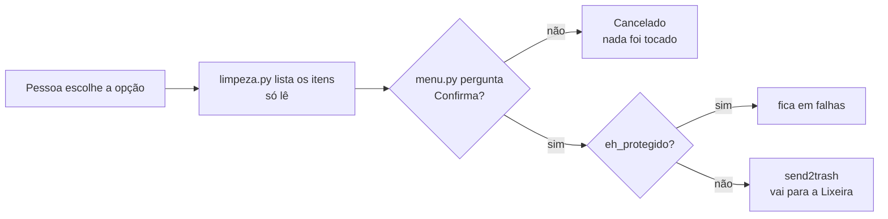

# 🧹 Help Desk · Faxineira de PC

Ferramenta de suporte técnico em Python que roda direto no **Windows 11** e ajuda a **diagnosticar e limpar** o computador, passo a passo, por um menu numerado.

Baseada num guia de faxina de PC que já era usado manualmente: o projeto automatiza as partes seguras dele.

  

| Camada | Tecnologia |
|---|---|
| Linguagem | Python 3.10+ (testado no 3.12) |
| Tela | terminal com `colorama` (cores) |
| Lixeira | `send2trash` (tudo vai para a Lixeira) |
| Registro do Windows | `winreg` (biblioteca padrão, só leitura) |
| Testes | `pytest` (54), sem tocar no disco de verdade |

## Regra de segurança número 1

**Nada é apagado direto.** Toda limpeza manda o item para a **Lixeira** do Windows, só depois de a pessoa **confirmar**. Itens de Windows, drivers, antivírus e WebView2 são **recusados pelo código**. A única ação sem volta é a opção 9 (esvaziar a Lixeira), e ela avisa antes. Veja [docs/seguranca.md](docs/seguranca.md).

## O que o menu faz

**Diagnóstico** (só leitura, nunca altera nada):
1. Espaço do disco C:
2. Tamanho das pastas de cada programa instalado
3. Maiores pastas do usuário (Downloads, Documentos...)
4. Itens de inicialização (o que abre sozinho com o Windows)
5. Mostrar as regras de segurança de novo

**Limpeza** (sempre para a Lixeira, sempre com confirmação):
6. Limpar Temp (`%TEMP%` e `C:\Windows\Temp`)
7. Limpar cache do Chrome
8. Procurar pastas de AppData que não batem com nenhum programa instalado (possíveis restos de programa desinstalado): mostra uma por uma e só move a que a pessoa confirmar
9. Esvaziar a Lixeira (ação final, sem volta)

## Fluxo de uma limpeza



## Como rodar

Pré-requisitos: Windows 11 e Python 3.10+.

```powershell
git clone https://github.com/matheusf8/help-desk.git
cd help-desk
pip install -r requirements.txt
python main.py
```

Testes:
```powershell
pytest
```

Passo a passo completo e problemas comuns em [docs/como-rodar.md](docs/como-rodar.md).

## Estrutura

```
help/
├── README.md
├── main.py                  ← porta de entrada (checa se é Windows)
├── faxineira/
│   ├── menu.py              ← tela, perguntas e loop principal
│   ├── textos.py            ← banner, menu e regras (só texto)
│   ├── diagnostico.py       ← só LÊ: disco, pastas, inicialização
│   ├── limpeza.py           ← Temp, Chrome, AppData, Lixeira, eh_protegido
│   └── utils.py             ← formatar_bytes, calcular_percentual, confirmar...
├── tests/                   ← 54 testes (limpeza, menu, utils, diagnostico)
├── docs/
│   ├── arquitetura.md       ← camadas, fluxo e pastas
│   ├── decisoes.md          ← por que cada escolha (18 decisões)
│   ├── seguranca.md         ← regras, revisão e riscos que restam
│   ├── como-rodar.md        ← instalação, uso e problemas comuns
│   ├── entrevista.md        ← pitch e perguntas com respostas
│   └── etapas/              ← um .md por etapa da reestruturação
├── pytest.ini
└── requirements.txt
```

## Documentação

| Quero... | Leia |
|---|---|
| rodar o programa passo a passo | [docs/como-rodar.md](docs/como-rodar.md) |
| entender as camadas e o fluxo | [docs/arquitetura.md](docs/arquitetura.md) |
| saber por que escolhi cada coisa | [docs/decisoes.md](docs/decisoes.md) |
| ver o que está protegido e o que falta | [docs/seguranca.md](docs/seguranca.md) |
| treinar para a entrevista | [docs/entrevista.md](docs/entrevista.md) |
| ver como cada etapa foi feita | [docs/etapas/](docs/etapas/) |

## Limites conhecidos (e próximos passos)

- Só funciona no **Windows** (usa registro e Lixeira do Windows); os testes também.
- A comparação do AppData com os programas instalados é uma **heurística** e pode errar; por isso é pasta por pasta.
- A opção 9 esvazia a Lixeira **inteira**, não só o que o programa moveu.
- Sem **log** do que foi movido e sem modo de **simulação** (*dry-run*).
- A proteção é por **nome**; falta proteger também por caminho (`Program Files`, `System32`).
- Funções que leem o registro (`itens_inicializacao`, `programas_instalados`) sem teste automatizado.

### Roadmap v2
Itens mais arriscados do guia original, deixados de fora da v1 de propósito:
- Editar chaves de registro de programas desinstalados (com backup `.reg` automático antes de qualquer edição)
- Desativar serviços do Windows (`sc config ... start= demand`)
- Desativar tarefas agendadas de apps
- Regras de firewall criadas por programas
- `DISM /Online /Cleanup-Image /StartComponentCleanup` (reduzir a pasta WinSxS)
- Varredura do Windows Defender via PowerShell

---

Desenvolvido por **Matheus Franco** com apoio do Claude Code.
