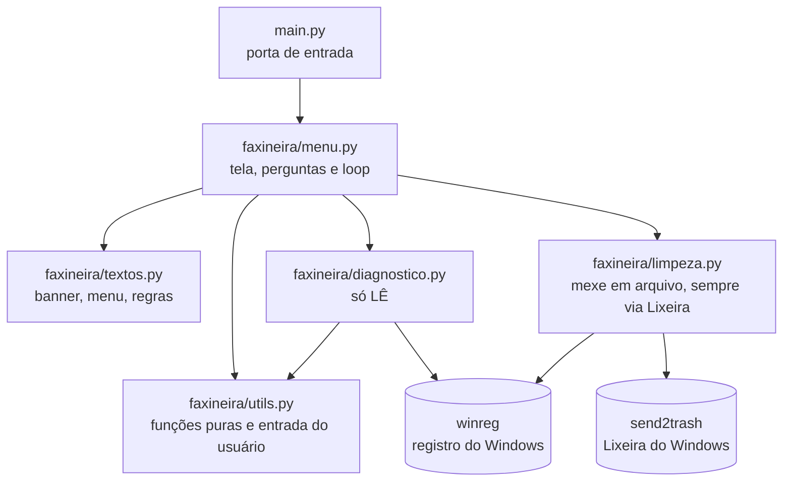
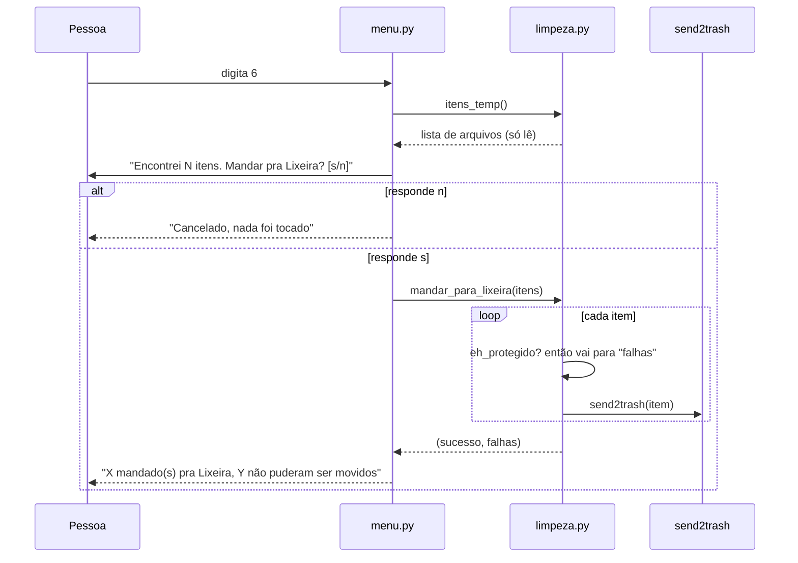

# Arquitetura

Como o código está dividido e por quê. A regra que guia tudo: **cada arquivo cuida de uma responsabilidade só.**

## Camadas



| Camada | Arquivo | Pode fazer | Não pode fazer |
|---|---|---|---|
| Entrada | `main.py` | checar se é Windows e chamar o menu | ter lógica de limpeza ou texto |
| Tela | `faxineira/menu.py` | imprimir, perguntar, decidir o fluxo | apagar arquivo por conta própria: sempre chama `limpeza` |
| Texto | `faxineira/textos.py` | guardar texto | ter lógica |
| Leitura | `faxineira/diagnostico.py` | ler disco, pastas e registro | apagar, mover ou alterar qualquer coisa |
| Escrita | `faxineira/limpeza.py` | mandar para a Lixeira, esvaziá-la | apagar direto; mexer em item protegido |
| Apoio | `faxineira/utils.py` | formatar bytes, calcular %, `confirmar` | depender do disco |

**A seta só vai para baixo:** `menu` conhece `limpeza`, mas `limpeza` não conhece `menu`. Por isso dá para testar `limpeza.py` sem simular tela nenhuma, e trocar a tela por uma página web mudaria só o `menu.py`.

## Fluxo de uma limpeza (opção 6, Temp)



Os três pontos de segurança estão na ordem: **listar** (só lê) → **confirmar** (pessoa decide) → **mandar para a Lixeira** (com a trava de protegidos).

## Estrutura de pastas

```
help/
├── main.py                  ← porta de entrada
├── faxineira/
│   ├── menu.py              ← funções rodar_*, ACOES e o loop executar()
│   ├── textos.py            ← BANNER, REGRAS_SEGURANCA, MENU
│   ├── diagnostico.py       ← espaço, pastas grandes, inicialização
│   ├── limpeza.py           ← Temp, cache do Chrome, AppData, Lixeira, eh_protegido
│   └── utils.py             ← formatar_bytes, calcular_percentual, confirmar...
├── tests/                   ← 54 testes (sem tocar no disco de verdade)
├── docs/                    ← esta documentação
├── pytest.ini
└── requirements.txt
```

## Por que não Docker
O programa precisa enxergar e mexer direto no Windows da pessoa (AppData, registro, Temp, Lixeira). Docker isola o contêiner do computador de propósito, então não serve aqui.

## Só funciona no Windows
`diagnostico.py` e `limpeza.py` importam `winreg`, que só existe no Windows. Por isso `main.py` checa `os.name` **antes** de importar o menu: em outro sistema a pessoa lê "Este programa foi feito para Windows 11" em vez de um erro de módulo.
